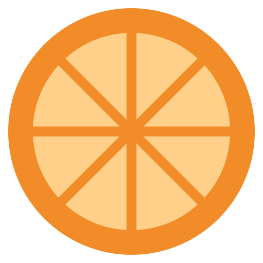

<p align="center">
  <picture>
    <source media="(prefers-color-scheme: dark)" srcset="docs/assets/logo-dark.svg">
    
  </picture>
</p>

# NogVita

Plataforma de acompanhamento nutricional que conecta **pacientes**, **nutricionistas** e **administradores**.

O paciente encontra um nutricionista e solicita acompanhamento. O nutricionista monta planos alimentares com cálculo nutricional automático, baseado em uma fonte externa de dados nutricionais.

> 🚧 **Projeto de estudo em desenvolvimento.** Criado para praticar .NET, arquitetura e engenharia de software.

## Funcionalidades

### Implementadas

- **Autenticação com JWT:** login, token de acesso de curta duração e endpoint de usuário autenticado
- **Refresh token:** renovação com rotação, detecção de reuso e logout
- **Papéis combináveis:** um mesmo usuário pode ser paciente, nutricionista e/ou administrador
- **Administrador inicial** criado automaticamente a partir da configuração
- **Validação de entrada:** requisições inválidas respondem 400 com os erros por campo
- **CPF validado:** normalização e verificação matemática dos dígitos verificadores
- **Política de senha** baseada na recomendação do NIST (SP 800-63B-4)
- **Cadastro de paciente:** conta e perfil em uma única etapa, só para maiores de 18 anos; a conta fica inativa até o e-mail ser confirmado
- **Confirmação de e-mail:** link de uso único, válido por 24 horas, com reenvio que revoga o link anterior
- **Recuperação de senha:** link de uso único por e-mail, válido por 1 hora; a troca encerra todas as sessões e envia um aviso
- **Perfil do paciente:** consulta e atualização dos próprios dados, com idade calculada e rotina opcional (horários de acordar, dormir e treinar)
- **Perfil do paciente para o nutricionista:** idade, sexo, altura, objetivo e rotina, só para quem o acompanha, sem CPF nem e-mail
- **Painel do administrador:** listagens paginadas de usuários, pacientes e nutricionistas, com busca e filtros
- **Ativação e desativação de contas:** desativar revoga todas as sessões do usuário. Desativar um nutricionista também encerra os acompanhamentos dele (os pacientes são avisados por e-mail e ficam livres para escolher outro), finaliza ou cancela os planos em aberto e recusa as solicitações pendentes
- **Pré-cadastro de nutricionistas pelo administrador**, com convite enviado por e-mail (link de uso único, válido por 72 horas). Um pré-cadastro nunca aceito pode ser cancelado, o que libera o CPF, o e-mail e o CRN
- **Aceite do convite:** um usuário novo define a senha (o que também confirma o e-mail, já que o link chegou nele); um usuário que já é paciente só ativa o novo papel, sem trocar a senha
- **Perfil do nutricionista:** consulta dos próprios dados e edição da apresentação (bio)
- **Lista de nutricionistas:** para qualquer usuário logado, paginada, com busca por nome e filtro por região do CRN, sem expor e-mail nem CPF
- **Acompanhamento nutricional:** o paciente solicita, o nutricionista aceita ou recusa, e qualquer um dos dois pode encerrar, com aviso por e-mail à outra parte
- **Base de alimentos:** 597 alimentos da TACO e 22.728 produtos brasileiros do [Open Food Facts](https://world.openfoodfacts.org), importados na inicialização, e outros produtos avulsos importados pelo código de barras; busca sem diferenciar acentos
- **Gestão de alimentos pelo administrador:** ativação e desativação
- **Plano alimentar:** o nutricionista cria, ativa e finaliza planos para os pacientes que acompanha, com até 10 refeições ordenadas e até 20 alimentos por refeição; o paciente vê o plano atual e o histórico
- **Cálculo nutricional:** porção de cada alimento, totais por refeição e do dia, e comparação com a meta diária de calorias e macronutrientes
- **Exportação em PDF:** o plano completo, para baixar ou receber por e-mail, no visual da marca
- **Registro de peso:** pelo paciente ou pelo nutricionista, um por dia, com o histórico e o IMC no detalhe do paciente
- **E-mails transacionais** com layout próprio (convite, confirmação, aviso de conta existente e encerramento de acompanhamento), enviados por SMTP em desenvolvimento e pela API HTTP da Brevo em staging

## Endpoints

| Método | Rota | Descrição |
|---|---|---|
| `POST` | `/api/v1/auth/login` | Autentica e devolve os tokens (`403` se o e-mail não foi confirmado) |
| `POST` | `/api/v1/auth/refresh` | Renova os tokens (com rotação) |
| `POST` | `/api/v1/auth/logout` | Encerra a sessão |
| `GET` | `/api/v1/auth/me` | Dados do usuário autenticado |
| `GET` | `/health` | Saúde da API e do banco |
| `POST` | `/api/v1/auth/register/patient` | Cadastra um paciente e envia o link de confirmação |
| `POST` | `/api/v1/auth/email-confirmation/confirm` | Confirma o e-mail e ativa a conta |
| `POST` | `/api/v1/auth/email-confirmation/resend` | Reenvia o link de confirmação (invalida os anteriores) |
| `POST` | `/api/v1/auth/password-reset/request` | Envia o link de redefinição de senha (invalida os anteriores) |
| `POST` | `/api/v1/auth/password-reset/confirm` | Define a nova senha e encerra todas as sessões |
| `GET` | `/api/v1/patients/me` | Perfil do paciente autenticado |
| `PUT` | `/api/v1/patients/me` | Atualiza o perfil do paciente autenticado |
| `GET` | `/api/v1/nutritionists` | Lista os nutricionistas ativos (paginado, com busca e filtro) |
| `GET` | `/api/v1/nutritionists/me` | Perfil do nutricionista autenticado |
| `PUT` | `/api/v1/nutritionists/me` | Atualiza a apresentação do nutricionista autenticado |
| `POST` | `/api/v1/patients/me/nutritionist-requests` | Paciente solicita acompanhamento a um nutricionista |
| `GET` | `/api/v1/patients/me/nutritionist-requests` | Solicitações do paciente (paginado, filtro por status) |
| `POST` | `/api/v1/patients/me/nutritionist-requests/{id}/cancel` | Paciente cancela uma solicitação pendente |
| `GET` | `/api/v1/patients/me/care-relationship` | Acompanhamento ativo do paciente |
| `POST` | `/api/v1/patients/me/care-relationship/end` | Paciente encerra o acompanhamento |
| `GET` | `/api/v1/nutritionists/me/requests` | Solicitações recebidas pelo nutricionista (paginado, filtro por status) |
| `POST` | `/api/v1/nutritionists/me/requests/{id}/accept` | Aceita a solicitação e cria o acompanhamento |
| `POST` | `/api/v1/nutritionists/me/requests/{id}/reject` | Recusa a solicitação |
| `GET` | `/api/v1/nutritionists/me/patients` | Pacientes em acompanhamento (paginado, busca por nome) |
| `GET` | `/api/v1/nutritionists/me/patients/{patientId}` | Perfil e rotina de um paciente acompanhado |
| `POST` | `/api/v1/nutritionists/me/patients/{patientId}/end` | Nutricionista encerra o acompanhamento de um paciente |
| `GET` | `/api/v1/foods` | Busca alimentos por nome (paginado, filtro por fonte) |
| `GET` | `/api/v1/foods/{id}` | Detalhes de um alimento |
| `GET` | `/api/v1/foods/barcode/{barcode}` | Prévia de um produto pelo código de barras |
| `POST` | `/api/v1/foods/barcode/{barcode}/import` | Importa um produto do Open Food Facts |
| `POST` | `/api/v1/admin/foods/{id}/activate` | Reativa um alimento |
| `POST` | `/api/v1/admin/foods/{id}/deactivate` | Desativa um alimento |
| `POST` | `/api/v1/nutritionists/me/nutrition-plans` | Cria um plano (rascunho) para um paciente |
| `GET` | `/api/v1/nutritionists/me/patients/{patientId}/nutrition-plans` | Planos de um paciente (paginado, filtro por status) |
| `GET` | `/api/v1/nutritionists/me/nutrition-plans/{id}` | Detalhes de um plano |
| `PUT` | `/api/v1/nutritionists/me/nutrition-plans/{id}` | Atualiza um plano em rascunho ou ativo |
| `POST` | `/api/v1/nutritionists/me/nutrition-plans/{id}/activate` | Ativa um rascunho (finaliza o plano ativo anterior) |
| `POST` | `/api/v1/nutritionists/me/nutrition-plans/{id}/finish` | Finaliza o plano ativo |
| `POST` | `/api/v1/nutritionists/me/nutrition-plans/{id}/cancel` | Cancela um rascunho |
| `POST` | `/api/v1/nutritionists/me/nutrition-plans/{planId}/meals` | Acrescenta uma refeição ao fim do plano |
| `PUT` | `/api/v1/nutritionists/me/nutrition-plans/{planId}/meals/{mealId}` | Atualiza uma refeição |
| `DELETE` | `/api/v1/nutritionists/me/nutrition-plans/{planId}/meals/{mealId}` | Remove uma refeição (renumera as demais) |
| `PUT` | `/api/v1/nutritionists/me/nutrition-plans/{planId}/meals/order` | Reordena as refeições |
| `POST` | `/api/v1/nutritionists/me/nutrition-plans/{planId}/meals/{mealId}/foods` | Adiciona um alimento à refeição |
| `PUT` | `/api/v1/nutritionists/me/nutrition-plans/{planId}/meals/{mealId}/foods/{mealFoodId}` | Altera a quantidade de um alimento da refeição |
| `DELETE` | `/api/v1/nutritionists/me/nutrition-plans/{planId}/meals/{mealId}/foods/{mealFoodId}` | Remove um alimento da refeição |
| `PUT` | `/api/v1/nutritionists/me/nutrition-plans/{id}/target` | Define a meta diária de calorias e macronutrientes |
| `DELETE` | `/api/v1/nutritionists/me/nutrition-plans/{id}/target` | Remove a meta do plano |
| `GET` | `/api/v1/nutritionists/me/nutrition-plans/{id}/pdf` | Baixa o PDF de um plano |
| `GET` | `/api/v1/patients/me/nutrition-plans/{id}/pdf` | Paciente baixa o PDF de um plano |
| `POST` | `/api/v1/patients/me/nutrition-plans/{id}/pdf/email` | Paciente recebe o PDF no próprio e-mail |
| `POST` | `/api/v1/patients/me/weight-records` | Paciente registra o próprio peso do dia |
| `GET` | `/api/v1/patients/me/weight-records` | Histórico de peso do paciente (paginado, filtro por período) |
| `DELETE` | `/api/v1/patients/me/weight-records/{id}` | Paciente apaga um registro que fez |
| `POST` | `/api/v1/nutritionists/me/patients/{patientId}/weight-records` | Nutricionista registra o peso de um paciente |
| `GET` | `/api/v1/nutritionists/me/patients/{patientId}/weight-records` | Histórico de peso de um paciente acompanhado |
| `DELETE` | `/api/v1/nutritionists/me/weight-records/{id}` | Nutricionista apaga um registro que fez |
| `GET` | `/api/v1/patients/me/nutrition-plans` | Planos do paciente (paginado, filtro por status) |
| `GET` | `/api/v1/patients/me/nutrition-plans/current` | Plano ativo do paciente |
| `GET` | `/api/v1/patients/me/nutrition-plans/{id}` | Detalhes de um plano do paciente |
| `GET` | `/api/v1/admin/users` | Lista usuários (paginado, com busca e filtro) |
| `GET` | `/api/v1/admin/users/{id}` | Detalhes de um usuário |
| `POST` | `/api/v1/admin/users/{id}/deactivate` | Desativa a conta e revoga as sessões (no nutricionista, encerra também os acompanhamentos) |
| `POST` | `/api/v1/admin/users/{id}/activate` | Reativa a conta |
| `GET` | `/api/v1/admin/patients` | Lista pacientes (paginado) |
| `GET` | `/api/v1/admin/patients/{id}` | Detalhes de um paciente |
| `GET` | `/api/v1/admin/nutritionists` | Lista nutricionistas (paginado) |
| `GET` | `/api/v1/admin/nutritionists/{id}` | Detalhes de um nutricionista |
| `POST` | `/api/v1/admin/nutritionists` | Pré-cadastra um nutricionista e envia o convite |
| `POST` | `/api/v1/admin/nutritionists/{id}/invitation` | Reenvia o convite (invalida os anteriores) |
| `DELETE` | `/api/v1/admin/nutritionists/{id}` | Cancela um pré-cadastro cujo convite nunca foi aceito |
| `POST` | `/api/v1/auth/invitations/accept` | Aceita o convite |

> 📘 Formatos de requisição e resposta, erros e fluxos estão no **[guia de consumo da API](docs/API.md)**.

### Confirmação de e-mail

O cadastro de paciente cria a conta **inativa** e envia um link de confirmação por e-mail, válido por 24 horas. A conta só é ativada quando o link é usado.

| Método | Rota | Resposta |
|---|---|---|
| `POST` | `/api/v1/auth/register/patient` | `202`, sempre com a mesma mensagem genérica |
| `POST` | `/api/v1/auth/email-confirmation/confirm` | `204` confirmado, `400` link inválido ou expirado |
| `POST` | `/api/v1/auth/email-confirmation/resend` | `202`, sempre com a mesma mensagem genérica |

O que acontece em cada caso de cadastro (a resposta é sempre a mesma `202`):

| Situação | Resultado |
|---|---|
| E-mail e CPF novos | Cria a conta inativa e envia o link de confirmação |
| E-mail de uma conta **pendente** | Gera um link novo (revogando o anterior) e reenvia; a senha não muda |
| E-mail de uma conta **confirmada** | Avisa o dono do e-mail que já existe uma conta |
| CPF de outra conta, com outro e-mail | Não cria nada; avisa o dono do CPF no e-mail cadastrado dele e registra um log, só com o Id |

Decisões de segurança:

- As respostas do cadastro e do reenvio são sempre iguais e não revelam se um e-mail ou CPF já está cadastrado.
- Se o e-mail ou o CPF já tem uma conta, o aviso vai para o e-mail **do dono da conta**, e nunca para o endereço digitado no formulário.
- Os tokens são guardados apenas como hash SHA-256, são de uso único, e cada reenvio revoga o link anterior.
- O login só informa "confirme seu e-mail" (`403`) depois de a senha estar correta.
- Um cadastro repetido nunca altera a senha da conta pendente.
- Os usuários que já existiam antes da confirmação de e-mail foram migrados como confirmados.

### Recuperação de senha

| Método | Rota | Resposta |
|---|---|---|
| `POST` | `/api/v1/auth/password-reset/request` | `202`, sempre com a mesma mensagem |
| `POST` | `/api/v1/auth/password-reset/confirm` | `204` senha alterada, `400` link inválido ou expirado |

O link de redefinição vale 1 hora, é de uso único, e um novo pedido invalida o anterior. Os tokens são guardados apenas como hash. Depois da troca, todas as sessões abertas são encerradas e o usuário recebe um aviso por e-mail. Se o e-mail ainda não tinha sido confirmado, a redefinição também o confirma. Contas desativadas pelo administrador e nutricionistas que ainda não aceitaram o convite não recebem o link.

Detalhes:

- **Sem enumeração de contas:** o pedido responde `202` com a mesma mensagem tanto para e-mails cadastrados quanto para os que não existem.
- **Desativação depois do pedido:** se o administrador desativar a conta depois que o link foi enviado, o link deixa de funcionar. Redefinir a senha nunca reativa uma conta desativada.
- **Por que confirmar o e-mail:** quem recebeu o link no e-mail provou ser dono dele. A data de confirmação original é mantida para quem já tinha confirmado.
- **Por que encerrar as sessões:** quem redefine a senha por suspeita de invasão precisa derrubar as sessões que o invasor tenha aberto.
- **A nova senha** segue a mesma política do cadastro (mínimo de 15 caracteres, com lista de bloqueio).
- As duas rotas ficam no limite de 10 requisições por minuto por IP, o que dificulta tanto o envio de e-mails em massa quanto as tentativas de adivinhar tokens.

### Nutricionista

| Método | Rota | Acesso | Descrição |
|---|---|---|---|
| `GET` | `/api/v1/nutritionists` | Usuário logado | Lista paginada de nutricionistas ativos (`search` por nome, `crnRegion`) |
| `GET` | `/api/v1/nutritionists/me` | Nutricionista | Perfil do próprio nutricionista |
| `PUT` | `/api/v1/nutritionists/me` | Nutricionista | Atualiza a apresentação (`bio`, até 500 caracteres) |

A lista nunca expõe e-mail nem CPF, e a busca considera apenas o nome. Só aparecem nutricionistas com a conta ativa **e** o convite aceito, em ordem alfabética.

A apresentação é normalizada no domínio: espaços nas pontas são removidos, e um texto em branco vira `null`, o que apaga a apresentação.

### Acompanhamento nutricional

O paciente solicita acompanhamento a um nutricionista. O aceite cria o vínculo, e qualquer um dos dois pode encerrá-lo; a outra parte é avisada por e-mail. Cada paciente tem no máximo um acompanhamento ativo e uma solicitação pendente por vez, regra garantida também por índices únicos parciais no PostgreSQL.

| Método | Rota | Acesso |
|---|---|---|
| `POST` | `/api/v1/patients/me/nutritionist-requests` | Paciente |
| `GET` | `/api/v1/patients/me/nutritionist-requests?status=` | Paciente |
| `POST` | `/api/v1/patients/me/nutritionist-requests/{id}/cancel` | Paciente |
| `GET` | `/api/v1/patients/me/care-relationship` | Paciente |
| `POST` | `/api/v1/patients/me/care-relationship/end` | Paciente |
| `GET` | `/api/v1/nutritionists/me/requests?status=` | Nutricionista |
| `POST` | `/api/v1/nutritionists/me/requests/{id}/accept` | Nutricionista |
| `POST` | `/api/v1/nutritionists/me/requests/{id}/reject` | Nutricionista |
| `GET` | `/api/v1/nutritionists/me/patients?search=` | Nutricionista |
| `GET` | `/api/v1/nutritionists/me/patients/{patientId}` | Nutricionista |
| `POST` | `/api/v1/nutritionists/me/patients/{patientId}/end` | Nutricionista |

O nutricionista só responde as solicitações destinadas a ele e só vê os próprios pacientes. Um recurso de outro usuário responde `404`.

**Perfil e rotina do paciente:** para montar o plano, o nutricionista vê a idade, o sexo biológico, a altura, o objetivo e a rotina de cada paciente que acompanha (`GET /nutritionists/me/patients/{patientId}`). A rota segue o princípio da necessidade da LGPD: devolve a **idade**, e não a data de nascimento, e não traz CPF nem e-mail. Depois que o acompanhamento termina, ela passa a responder `404`.

A rotina (horários de acordar, dormir e treinar) é preenchida pelo próprio paciente no `PUT /patients/me`, e os três campos são **opcionais**: um campo obrigatório travaria os cadastros que já existem. Não há regra de "janela": quem trabalha à noite pode acordar às 14h e dormir às 6h. A única recusa é a hora de acordar igual à de dormir.

Ciclo de vida de uma solicitação:

```
Pending ──aceite──▶ Accepted  (cria o acompanhamento)
   ├────recusa───▶ Rejected
   └──cancelamento▶ Cancelled (pelo paciente)
```

- Só uma solicitação `Pending` pode ser respondida ou cancelada; nos outros estados, a resposta é `409`.
- Os dois índices únicos parciais (`status = 'Pending'` e `ended_at_utc IS NULL`) protegem a regra mesmo com duas requisições simultâneas, que a checagem no código sozinha não pegaria.
- Encerrar não apaga nada: o vínculo ganha a data de encerramento e quem encerrou, preservando o histórico.
- **Nutricionista desativado:** quando o administrador desativa a conta de um nutricionista, os acompanhamentos dele são encerrados em nome do admin, e as solicitações pendentes passam a `Rejected`. Sem isso, o paciente ficaria preso a um acompanhamento que ninguém mais consegue encerrar e não poderia pedir outro nutricionista. Reativar a conta não recria os acompanhamentos.

### Alimentos

A base de alimentos combina duas fontes, e cada alimento informa a sua origem:

- **TACO 4ª edição (NEPA/UNICAMP):** 597 alimentos genéricos brasileiros, importados automaticamente na inicialização.
- **Open Food Facts (ODbL):** produtos industrializados, de dois jeitos:
  - **uma base de 22.728 produtos brasileiros**, importada em segundo plano na inicialização, para a busca por nome já encontrar os produtos de mercado;
  - **produtos avulsos**, importados pelo código de barras quando o nutricionista confirma (os que não estão na base).

Os valores são guardados por 100 g. Valores fisicamente impossíveis são recusados: mais de 100 g de um nutriente, ou mais de 100 g de proteína, carboidrato e gordura somados, em 100 g de alimento.

| Método | Rota | Acesso | Descrição |
|---|---|---|---|
| `GET` | `/api/v1/foods?search=&source=` | Nutricionista, Admin | Busca por palavras no nome, em qualquer ordem, sem diferenciar acentos e maiúsculas |
| `GET` | `/api/v1/foods/{id}` | Nutricionista, Admin | Detalhe do alimento |
| `GET` | `/api/v1/foods/barcode/{barcode}` | Nutricionista, Admin | Prévia do produto: primeiro na base local, depois no Open Food Facts |
| `POST` | `/api/v1/foods/barcode/{barcode}/import` | Nutricionista, Admin | Importa o produto (`201`, ou `200` se já existia) |
| `POST` | `/api/v1/admin/foods/{id}/activate` | Admin | Reativa um alimento |
| `POST` | `/api/v1/admin/foods/{id}/deactivate` | Admin | Desativa um alimento (ele some da busca) |

**TACO:**

- A importação roda na inicialização e é idempotente: se já existe algum alimento da TACO no banco, ela não faz nada.
- O CSV vai embutido na DLL, e a origem dos dados (commit, hash, conferência com a planilha oficial e o significado dos marcadores `Tr`, `NA` e `*`) está documentada em [`SOURCE.md`](src/NogVita.Infrastructure/Persistence/Seed/Data/SOURCE.md).
- Traço (`Tr`) vira 0. Nutriente não analisado ou não aplicável vira `null`, que significa "sem informação", e nunca zero.

**Base brasileira do Open Food Facts (importação em massa):**

- **De onde vem:** um recorte dos produtos vendidos no Brasil, tirado do `food.parquet` que o Open Food Facts publica no Hugging Face (4,8 milhões de produtos do mundo todo) e filtrado com o DuckDB. O resultado é um CSV de 2 MB (`off_brasil.csv`), embutido na DLL como o da TACO.
- **O filtro aplica todas as regras do domínio**, para nenhum produto ser recusado no meio da importação: código de barras válido, nome e marca dentro do tamanho máximo, os limites físicos de cada nutriente, a soma dos macronutrientes e o sódio. Ele também exclui os produtos com **energia incoerente** com os macronutrientes pelos fatores de Atwater (diferença maior que 20% ou 20 kcal). Essa regra vale só para a importação em massa, porque ninguém revisa milhares de produtos, ao contrário da importação avulsa, em que o nutricionista vê a prévia. Dos 37.060 produtos brasileiros, 22.728 passaram.
- **Um teste garante o filtro:** ele passa cada uma das 22.728 linhas pelo domínio de verdade (`OpenFoodFactsCsvReaderTests`). Se o filtro esquecer alguma regra, o teste mostra qual produto falha.
- **Fibra e sódio não são exigidos:** 8.619 produtos não informam a fibra, e 7.355, o sódio. Eles entram assim mesmo, e o total do nutriente que falta aparece como incompleto, e nunca como zero.
- **Em segundo plano:** a importação roda num `BackgroundService` depois que a API já está atendendo, para a Render não cancelar o deploy por demora na inicialização. Enquanto ela roda, o resto da API funciona normalmente.
- **Em lotes de mil:** cada lote é salvo e "esquecido" pelo EF (`ChangeTracker.Clear()`), para a memória não crescer com dezenas de milhares de objetos (o plano gratuito da Render tem 512 MB). No banco local, a importação inteira leva cerca de 8 segundos.
- **Idempotente pelo código de barras:** só entram os códigos que ainda não existem. Se a importação for interrompida (num deploy, ou quando a Render "dorme" a API), a próxima inicialização continua de onde parou, e um produto importado antes, ou desativado pelo administrador, não é duplicado nem reativado.
- **Uma linha com problema não derruba as outras:** se o domínio recusar um produto, ele é pulado e registrado no log com o motivo, e a importação continua. Diferente da TACO, que é tudo ou nada, porque um erro num produto da comunidade não diz nada sobre os outros.
- **Busca por palavras:** cada palavra digitada precisa aparecer no nome, em qualquer ordem e posição. Assim, "coca zero" encontra "Coca-Cola Zero Açúcar", e "arroz tipo 1 cozido" encontra o "Arroz, tipo 1, cozido" da TACO. Hífen e pontuação também separam as palavras, porque a base escreve "Coca-Cola" e "Coca Cola" dos dois jeitos. A busca usa no máximo 8 palavras, e com os 23 mil alimentos responde em cerca de 50 ms no banco local.
- **Espaço no banco:** a tabela de alimentos ocupa cerca de 7,5 MB com os índices, em torno de 1,5% dos 500 MB do plano gratuito do Supabase.
- **Origem, filtro completo e licença:** o SQL para reproduzir o arquivo, os números de cada etapa do filtro e as limitações conhecidas estão em [`SOURCE-OFF.md`](src/NogVita.Infrastructure/Persistence/Seed/Data/SOURCE-OFF.md).

**Open Food Facts (produto avulso, pelo código de barras):**

- **Prévia antes de importar:** a consulta pelo código de barras não grava nada. O nutricionista vê os dados e só então confirma a importação.
- **Base local primeiro:** se o produto já foi importado, a prévia e a importação usam a base local, sem chamar o serviço externo. Um produto desativado pelo administrador não volta por uma nova importação.
- **Validação antes da chamada externa:** um código que não tem só dígitos ou não tem 8, 12, 13 ou 14 dígitos responde `400` sem consultar o Open Food Facts.
- **Nome em português primeiro:** usa o nome em português quando existe; produto sem nome nenhum é tratado como não encontrado, porque não serve para um plano alimentar.
- **Dados inconsistentes:** um produto com valores impossíveis no Open Food Facts responde `422` e não é importado.
- **Falhas isoladas:** timeout, erro do serviço externo ou resposta inesperada viram `503`, sem derrubar a requisição com erro `500`.
- **Boa convivência com a API pública:** as chamadas se identificam com um `User-Agent` com e-mail de contato, como o Open Food Facts pede. A prévia e a importação dividem um limite de 10 requisições por minuto por usuário.

**Fontes dos dados:** NEPA – UNICAMP. *Tabela Brasileira de Composição de Alimentos – TACO*. 4. ed. rev. e ampl. Campinas: NEPA-UNICAMP, 2011. · [Open Food Facts](https://world.openfoodfacts.org), sob a [Open Database License (ODbL)](https://opendatacommons.org/licenses/odbl/1-0/).

### Plano alimentar

O nutricionista cria planos para os pacientes que acompanha. Um plano nasce como rascunho (`Draft`), é ativado (`Active`) e depois finalizado (`Finished`); um rascunho pode ser cancelado (`Cancelled`). Cada paciente tem no máximo um plano ativo: ativar um novo finaliza o anterior. Encerrar o acompanhamento finaliza o plano ativo e cancela os rascunhos daquele nutricionista. O paciente vê apenas os planos ativos e finalizados, inclusive os de nutricionistas anteriores.

| Método | Rota | Acesso |
|---|---|---|
| `POST` | `/api/v1/nutritionists/me/nutrition-plans` | Nutricionista |
| `GET` | `/api/v1/nutritionists/me/patients/{patientId}/nutrition-plans?status=` | Nutricionista |
| `GET` | `/api/v1/nutritionists/me/nutrition-plans/{id}` | Nutricionista |
| `PUT` | `/api/v1/nutritionists/me/nutrition-plans/{id}` | Nutricionista |
| `POST` | `/api/v1/nutritionists/me/nutrition-plans/{id}/activate` | Nutricionista |
| `POST` | `/api/v1/nutritionists/me/nutrition-plans/{id}/finish` | Nutricionista |
| `POST` | `/api/v1/nutritionists/me/nutrition-plans/{id}/cancel` | Nutricionista |
| `GET` | `/api/v1/patients/me/nutrition-plans?status=` | Paciente |
| `GET` | `/api/v1/patients/me/nutrition-plans/current` | Paciente |
| `GET` | `/api/v1/patients/me/nutrition-plans/{id}` | Paciente |

O nutricionista só acessa os próprios planos, e apenas enquanto o acompanhamento estiver ativo. As datas seguem o horário de Brasília.

Ciclo de vida:

```
Draft ──activate──▶ Active ──finish──▶ Finished
  │                   └── ativar outro plano do paciente ──▶ Finished
  └──cancel──▶ Cancelled
```

| Ação | Permitida em | Fora disso |
|---|---|---|
| Editar (`PUT`) | `Draft` e `Active` | `409` |
| Ativar | `Draft` | `409` |
| Finalizar | `Active` | `409` |
| Cancelar | `Draft` | `409` |

Regras:

- **Um plano ativo por vez:** a ativação finaliza o plano ativo anterior e ativa o novo dentro de uma **transação**, nessa ordem. O índice único parcial `ux_nutrition_plan_patient_active` (`status = 'Active'`) garante a regra também no banco.
- **Data de fim ao finalizar:** se o plano não tinha data de fim, ou se ela ainda não chegou, a data de fim vira o dia da finalização. Ela nunca fica antes da data de início.
- **Acesso:** sem acompanhamento ativo, as rotas do nutricionista respondem `404` (e não `403`), sem revelar se o plano ou o paciente existe. Um plano de outro nutricionista também responde `404`.
- **O que o paciente vê:** rascunhos e planos cancelados nunca aparecem para ele, nem na lista, nem no detalhe. A lista mostra o plano ativo primeiro e depois os finalizados, do mais recente para o mais antigo.
- **Histórico preservado:** encerrar o acompanhamento ou trocar de nutricionista não apaga nada. Os planos finalizados continuam visíveis para o paciente.

#### Refeições

As refeições fazem parte do plano: são criadas, alteradas, removidas e reordenadas sempre através dele, e só enquanto o plano estiver em rascunho ou ativo. A ordem é sempre sequencial (1, 2, 3...): uma refeição nova entra no fim, a remoção renumera as demais, e a reordenação recebe a lista completa. Um plano tem no máximo 10 refeições. O detalhe do plano (nutricionista e paciente) traz as refeições em ordem.

| Método | Rota | Acesso |
|---|---|---|
| `POST` | `/api/v1/nutritionists/me/nutrition-plans/{planId}/meals` | Nutricionista |
| `PUT` | `/api/v1/nutritionists/me/nutrition-plans/{planId}/meals/{mealId}` | Nutricionista |
| `DELETE` | `/api/v1/nutritionists/me/nutrition-plans/{planId}/meals/{mealId}` | Nutricionista |
| `PUT` | `/api/v1/nutritionists/me/nutrition-plans/{planId}/meals/order` | Nutricionista |

Detalhes:

- **Agregado:** a refeição não tem regra própria fora do plano. Quem garante a ordem sequencial, o limite de 10 e o bloqueio em planos finalizados ou cancelados é o `NutritionPlan`, e a refeição só é alterada pelos métodos dele.
- **Reordenação completa:** a lista precisa ter todas as refeições do plano, cada uma uma vez. Uma lista incompleta, com repetidos ou com Id de outro plano responde `400`, e nada muda. Mandar a lista inteira evita estados intermediários, como duas refeições na mesma posição.
- **Respostas:** criar responde `201` com o Id da refeição, e as outras ações respondem `204`. Plano finalizado ou cancelado e limite de refeições atingido respondem `409`. Plano ou refeição que não existem, ou que não são do nutricionista, respondem `404`.
- **Formato do detalhe:** as rotas de detalhe do plano devolvem `{ "plan": { ... }, "meals": [ ... ] }`, com as refeições já em ordem.
- **Horário sugerido:** cada refeição pode ter um horário sugerido (`suggestedTime`), opcional. Ele não define a ordem, que continua manual: o jantar de quem trabalha à noite pode ser às 3h e ainda assim vir depois do almoço. A API aceita qualquer horário e **não bloqueia** nenhum.
- **Aviso de horário fora da rotina:** no detalhe do plano, cada refeição traz `outsideRoutine`, calculado pela API com a rotina **atual** do paciente. Ele é `true` quando a refeição cai enquanto o paciente dorme (uma ceia às 23:30 para quem dorme às 22:30), e `null` quando o paciente não informou a rotina ou a refeição não tem horário. A regra fica no domínio (`AwakeWindow`) e cobre a janela que atravessa a meia-noite: para quem acorda às 14h e dorme às 6h, um jantar às 3h **não** gera aviso. Os horários de acordar e de dormir contam como acordado. Como o cálculo é feito na leitura, se o paciente mudar a rotina, os avisos acompanham sem ninguém editar o plano.

#### Alimentos da refeição

Cada refeição recebe alimentos da base (TACO ou Open Food Facts) com a quantidade em gramas (ou ml, para bebidas), maior que 0 e até 2.000 g. Ao adicionar um alimento, o plano guarda uma cópia (snapshot) do nome, da marca, da fonte, da referência na fonte e dos valores por 100 g daquele momento: planos antigos não mudam quando a base de alimentos é atualizada ou um alimento é desativado. Alimentos inativos não podem ser adicionados, e o mesmo alimento não se repete na mesma refeição (até 20 alimentos por refeição).

| Método | Rota | Acesso |
|---|---|---|
| `POST` | `/api/v1/nutritionists/me/nutrition-plans/{planId}/meals/{mealId}/foods` | Nutricionista |
| `PUT` | `/api/v1/nutritionists/me/nutrition-plans/{planId}/meals/{mealId}/foods/{mealFoodId}` | Nutricionista |
| `DELETE` | `/api/v1/nutritionists/me/nutrition-plans/{planId}/meals/{mealId}/foods/{mealFoodId}` | Nutricionista |

Detalhes:

- **Por que o snapshot:** um plano é um registro do que foi prescrito. Se o Open Food Facts corrigir os valores de um produto, ou o administrador desativar um alimento, o plano de três meses atrás continua mostrando exatamente o que o paciente recebeu. A cópia guarda também a data em que foi tirada (`snapshotTakenAtUtc`).
- **Mesma precisão do original:** os nutrientes do snapshot usam o mesmo mapeamento da `tb_food` (`NutrientsMapping`, `numeric(9,4)`), configurado num lugar só, para as duas tabelas nunca divergirem.
- **Item, e não alimento:** cada alimento adicionado vira um item da refeição (`mealFoodId`). Alterar a quantidade e remover usam o Id do **item**, e não o do alimento.
- **Regras garantidas em duas camadas:** o caso de uso responde com uma mensagem clara, e o domínio (`Meal.AddFood`) recusa do mesmo jeito se alguém chamar direto. O índice único `ux_meal_food_meal_food` garante no banco que o mesmo alimento não se repete na refeição.
- **Respostas:** adicionar responde `201` com o Id do item, e as outras ações respondem `204`.
  - Alimento inexistente ou inativo → `404` ("Alimento não encontrado ou indisponível.").
  - Alimento repetido → `409` ("Este alimento já está na refeição. Altere a quantidade dele.").
  - Limite de 20 → `409`.
  - Plano finalizado ou cancelado → `409`.
  - Plano, refeição ou item que não existem, ou que não são do nutricionista → `404`.
- **No detalhe do plano,** cada refeição traz `foods`, na ordem em que foram adicionados, com a quantidade, os dados do snapshot e o texto de atribuição da fonte (`attribution`).

#### Cálculo nutricional

O sistema calcula os nutrientes de cada alimento na quantidade escolhida (`valor por 100 g × gramas ÷ 100`), o total de cada refeição e o total do dia: calorias, proteínas, carboidratos, gorduras, fibras e sódio. Os totais são sempre recalculados a partir dos alimentos e das quantidades, e nunca armazenados. As contas usam a precisão completa, e só a resposta é arredondada (uma casa decimal). Quando um alimento não informa um nutriente, o total daquele nutriente é marcado como incompleto (`isComplete: false`), em vez de tratar a informação ausente como zero.

O nutricionista pode definir uma meta diária (calorias e, opcionalmente, proteínas, carboidratos e gorduras), e o detalhe do plano mostra o total planejado comparado com a meta.

| Método | Rota | Acesso |
|---|---|---|
| `PUT` | `/api/v1/nutritionists/me/nutrition-plans/{id}/target` | Nutricionista |
| `DELETE` | `/api/v1/nutritionists/me/nutrition-plans/{id}/target` | Nutricionista |

Onde cada valor aparece no detalhe do plano:

| Nível | Campo |
|---|---|
| Alimento | `meals[].foods[].portion` |
| Refeição | `meals[].totals` |
| Dia | `dailyTotals` |
| Meta | `target` (meta, planejado e diferença de cada nutriente; ausente se o plano não tem meta) |

Detalhes:

- **Total incompleto:** a soma considera só os valores conhecidos, então o total real pode ser maior. O front deve mostrar algo como "pelo menos 25 g de fibra" (o PDF usa `≥ 25,0`).
- **Arredondamento:** uma casa decimal, com o meio arredondado para longe do zero (0,25 vira 0,3). Como só a resposta é arredondada, somar porções não acumula erro nos totais.
- **Diferença em relação à meta:** `difference = planejado − meta`. Negativo significa abaixo da meta, e positivo, acima. Um macronutriente sem meta vem `null` em `target`.
- **Limites da meta:** calorias maiores que 0 e até 10.000 kcal; cada macronutriente de 0 a 1.000 g. A meta só pode ser definida ou removida em planos em rascunho ou ativos (`409` nos outros).
- **Onde fica cada regra:** a conta da porção (`NutritionCalculator`), a soma com `isComplete` (`NutrientTotals`) e os limites da meta (`PlanTarget`) ficam no domínio, testados sem banco. A Application só arredonda e monta as respostas.

#### Exportar o plano

O plano pode ser exportado em PDF, com as refeições, as porções, os totais, a meta e a citação das fontes dos dados. O paciente pode baixar o PDF ou recebê-lo por e-mail, sempre no endereço da própria conta (até 3 envios por hora). O nutricionista pode baixar o PDF dos planos dos pacientes que acompanha.

| Método | Rota | Acesso |
|---|---|---|
| `GET` | `/api/v1/patients/me/nutrition-plans/{id}/pdf` | Paciente |
| `POST` | `/api/v1/patients/me/nutrition-plans/{id}/pdf/email` | Paciente |
| `GET` | `/api/v1/nutritionists/me/nutrition-plans/{id}/pdf` | Nutricionista |

Detalhes:

- **Mesmo acesso do detalhe:** o PDF segue as mesmas regras das rotas de detalhe. O paciente só exporta planos ativos ou finalizados, e o nutricionista só os que criou, enquanto o acompanhamento estiver ativo. Fora disso, a resposta é `404`.
- **E-mail sempre para o dono da conta:** a rota não recebe endereço. O PDF vai para o e-mail cadastrado do paciente, então ninguém usa a API para mandar o plano de outra pessoa para fora. O limite de 3 envios por hora é **por usuário** (`429` acima disso). Se o envio falhar, a resposta é `503`, sugerindo baixar o PDF.
- **O PDF segue a identidade visual dos e-mails:** a faixa laranja, a logo e os blocos de destaque cor de polpa. O arquivo se chama `nogvita-plano-AAAA-MM-DD.pdf`, com a data de início do plano.
- **Gerado na hora:** o PDF é montado a cada pedido (QuestPDF), a partir do mesmo detalhe que a API devolve, e não é guardado. A fonte Roboto vai embutida na DLL, para o PDF sair igual em qualquer servidor, inclusive no contêiner Linux do staging.

### Registro de peso

O paciente registra o próprio peso, e o nutricionista que o acompanha registra o peso medido na consulta. Cada registro guarda quem o fez. Há no máximo um registro por paciente por dia (de hoje até 365 dias atrás): registrar de novo no mesmo dia substitui o próprio registro, mas não o de outra pessoa. Só o autor pode apagar um registro. O detalhe do paciente para o nutricionista mostra o peso mais recente e o IMC, calculado a partir do peso e da altura.

| Método | Rota | Acesso |
|---|---|---|
| `POST` | `/api/v1/patients/me/weight-records` | Paciente |
| `GET` | `/api/v1/patients/me/weight-records?from=&to=` | Paciente |
| `DELETE` | `/api/v1/patients/me/weight-records/{id}` | Paciente |
| `POST` | `/api/v1/nutritionists/me/patients/{patientId}/weight-records` | Nutricionista |
| `GET` | `/api/v1/nutritionists/me/patients/{patientId}/weight-records?from=&to=` | Nutricionista |
| `DELETE` | `/api/v1/nutritionists/me/weight-records/{id}` | Nutricionista |

Detalhes:

- **Registrar responde de dois jeitos:** `201` quando cria o registro do dia, e `200` quando substitui o próprio registro daquele dia, os dois com `{ "id": ... }`. Se o registro do dia já foi feito pela outra pessoa (o paciente ou o nutricionista), a resposta é `409`, e nada é sobrescrito: o peso medido na consulta não some porque o paciente se pesou em casa, e vice-versa.
- **Um por dia, também no banco:** o índice único `ux_weight_record_patient_day` (paciente + data) garante a regra mesmo com duas requisições ao mesmo tempo.
- **A data é opcional:** sem a data, o registro é de hoje, no horário de Brasília. Uma data futura, ou de mais de 365 dias atrás, responde `400`.
- **Limites:** peso de 20 a 400 kg, guardado com duas casas decimais (78,456 vira 78,46); observações de até 300 caracteres.
- **Histórico:** paginado, do mais recente para o mais antigo, com filtro opcional por período (`from` e `to`). Cada item informa o peso, a data, as observações, quem registrou (`recordedByName`) e se foi o próprio paciente (`recordedByPatient`).
- **Acesso do nutricionista:** registrar, ver o histórico e apagar exigem um acompanhamento ativo com o paciente. Fora disso, a resposta é `404`. Ele só apaga os registros que fez.
- **IMC derivado:** o IMC (`bodyMassIndex`, com uma casa decimal) é calculado a cada consulta, a partir do peso mais recente e da altura do perfil, e nunca guardado. Se o paciente registrar um peso novo, o IMC muda sozinho. Sem nenhum peso registrado, ele vem `null`.

## Ambiente de staging

O ambiente de testes está publicado em:

- **Front:** `https://nogvita-green.vercel.app`
- **API:** `https://nogvitaapi.onrender.com`
- **Swagger:** `https://nogvitaapi.onrender.com/swagger`

> A API usa o plano gratuito da Render: depois de 15 minutos sem uso, ela "dorme", e a primeira requisição pode levar cerca de 1 minuto. Use **apenas dados de teste**.

### Para o frontend

- **Origens liberadas no CORS:** `https://nogvita-green.vercel.app` (o front oficial do staging) e `http://localhost:5173` (o padrão do Vite, para desenvolver na própria máquina usando a API do staging). Acesse o ambiente local sempre por `localhost`, e não por `127.0.0.1`. Os endereços de *preview* da Vercel (um por branch) **não** estão liberados, de propósito.
- **Links dos e-mails:** a confirmação de e-mail, a redefinição de senha e o convite de nutricionista apontam para o front da Vercel. Como o Vue Router usa `createWebHistory()`, a Vercel precisa devolver o `index.html` para qualquer rota, senão abrir um link direto como `/confirmar-email` dá `404` da Vercel. Isso se resolve com um `vercel.json` na raiz do front: `{ "rewrites": [{ "source": "/(.*)", "destination": "/index.html" }] }`.
- **Autenticação:** envie o token de acesso no header `Authorization: Bearer <accessToken>`. O token de acesso dura 15 minutos; use o `POST /api/v1/auth/refresh` com o `refreshToken` para obter um par novo. Faça **uma renovação por vez**: duas renovações simultâneas com o mesmo refresh token encerram todas as sessões (detecção de reuso).
- **Erros:** todas as respostas de erro seguem o formato `ProblemDetails` (`title`, `status` e, em erros de validação, `errors` por campo).
- **Enums:** trafegam como texto (ex.: `"goal": "MuscleGain"`).
- **Horários** (rotina do paciente e refeições): no formato `"HH:mm"` na entrada (`"07:00"`), e voltam com segundos (`"07:00:00"`). São horários locais, sem data e sem fuso.
- **Cadastro de paciente:** responde `202` **sem tokens**. Mostre "verifique seu e-mail", e não faça login automático.
- **Confirmação de e-mail:** o link abre `/confirmar-email#token=...` no front. A tela lê o token do fragmento da URL e o envia no corpo do `POST /api/v1/auth/email-confirmation/confirm`.
- **Login com e-mail não confirmado:** um `403` significa "e-mail não confirmado". Mostre a opção de reenviar o link (`POST /api/v1/auth/email-confirmation/resend`).
- **Redefinição de senha:** o link abre `/redefinir-senha#token=...` no front. A tela lê o token do fragmento da URL, pede a nova senha e envia os dois no corpo do `POST /api/v1/auth/password-reset/confirm`. A tela de login precisa de um "Esqueci minha senha" que chame o `POST /api/v1/auth/password-reset/request`.
- **Convite de nutricionista:** o e-mail leva para `/nutri/convite#token=...`. O Vue Router precisa usar `createWebHistory()` (e não o modo hash). A tela lê o token do fragmento da URL e o envia no corpo do `POST /api/v1/auth/invitations/accept`.
- **Termos de Uso e Política de Privacidade:** os textos ficam em [`docs/legal/`](docs/legal/) (veja [Termos de Uso e Privacidade](#termos-de-uso-e-privacidade)). No cadastro de paciente, além da frase de concordância, inclua um *checkbox* desmarcado de consentimento para os dados de saúde.

O guia completo, com exemplos de cada endpoint, está em [docs/API.md](docs/API.md).

## Stack

**Em uso:** C# · .NET 10 · ASP.NET Core Web API · Entity Framework Core · PostgreSQL · JWT · FluentValidation · xUnit · Docker (banco de dados) · OpenAPI / Swagger UI · TACO (tabela brasileira de composição de alimentos) · Open Food Facts (API pública de alimentos) · Brevo (e-mail em staging) · QuestPDF (PDF)

**Planejado:** Docker Compose (API + banco) · testes de integração

## Arquitetura

Clean Architecture em quatro camadas:

```
src/
├── NogVita.Api              → exposição HTTP
├── NogVita.Application      → casos de uso e validação de entrada
├── NogVita.Domain           → entidades, value objects e regras de negócio
└── NogVita.Infrastructure   → banco de dados, segurança e integrações externas

tests/
├── NogVita.UnitTests
└── NogVita.IntegrationTests
```

**Regra de dependência:** o Domain não depende de nenhuma outra camada nem de pacotes externos. A Application define contratos (repositórios, hash de senha, geração de tokens), e a Infrastructure os implementa.

**Duas camadas de validação:**
- **Entrada (FluentValidation):** verifica se a requisição está bem preenchida e devolve todos os erros de uma vez
- **Domínio (entidades e value objects):** garante que nenhum objeto inválido exista, como um CPF com dígitos verificadores errados

**Leitura e escrita separadas (CQRS leve):** as operações que alteram dados passam por casos de uso e pelas regras do domínio. As listagens usam serviços de consulta que projetam direto do banco para o DTO, com paginação e sem carregar entidades inteiras.

## Segurança

- Senhas armazenadas com PBKDF2 (HMAC-SHA512, 100 mil iterações). Se os parâmetros do hash mudarem, o hash antigo é refeito no próximo login bem-sucedido, sem pedir uma senha nova
- Login com tempo de resposta uniforme: quando o e-mail não existe (ou a conta ainda não tem senha), a senha é verificada contra um hash falso, com o mesmo custo. Assim, o tempo não revela quais e-mails estão cadastrados
- Política de senha do NIST: mínimo de 15 caracteres, sem regras de composição e com lista de bloqueio
- Refresh tokens armazenados apenas como hash SHA-256
- Mesma resposta para qualquer falha de login, evitando enumeração de usuários
- Limite de tamanho em senhas e tokens, protegendo o servidor contra entradas gigantes
- Segredos fora do código (User Secrets em desenvolvimento)
- Nenhum dado pessoal nos tokens nem nos logs
- Autorização por papel (`Patient`, `Nutritionist`, `Admin`) e acesso aos próprios dados sempre pelo token, nunca por Ids enviados pelo cliente
- Conflitos de cadastro com mensagem genérica, sem revelar se um CPF ou e-mail já tem conta (LGPD)
- Tokens de convite, de confirmação de e-mail e de redefinição de senha armazenados apenas como hash, com validade e uso único
- Redefinir a senha encerra todas as sessões abertas e avisa o dono da conta por e-mail
- O link do convite leva o token no fragmento da URL, que nunca é enviado a servidores
- O aceite do convite nunca altera a senha de uma conta existente
- Cabeçalhos de segurança em todas as respostas, inclusive nos erros 401, 403 e 429: `X-Content-Type-Options: nosniff`, `X-Frame-Options: DENY` e `Referrer-Policy: no-referrer`. Nas rotas `/api`, também `Content-Security-Policy: default-src 'none'; frame-ancestors 'none'` e `Cache-Control: no-store`, para dados de saúde não ficarem no cache do navegador (o Swagger fica de fora, porque precisa carregar os próprios scripts)
- Sem o cabeçalho `Server: Kestrel`, que anunciaria a tecnologia do servidor
- `AllowedHosts` restrito (`localhost` em desenvolvimento, `nogvitaapi.onrender.com` no staging): requisições com outro `Host` recebem `400`. Os links dos e-mails já usam o `Frontend:BaseUrl`, nunca o `Host` da requisição; a restrição é uma segunda camada

## Termos de Uso e Privacidade

Os documentos que o front exibe ao usuário ficam em [`docs/legal/`](docs/legal/):

- [Termos de Uso](docs/legal/termos-de-uso.md)
- [Política de Privacidade](docs/legal/politica-de-privacidade.md)

A política segue a LGPD e descreve o que o sistema faz de fato: os dados guardados, quem pode ver cada um, os serviços que tratam os dados (Render, Vercel e Brevo) e os direitos do titular.

> **Textos de um projeto de estudo:** foram escritos com base no que o sistema faz de fato, mas não substituem a revisão de um advogado.

Pontos em aberto, para o sistema cumprir o que os documentos prometem:

- **Consentimento para dados de saúde:** data de nascimento, sexo biológico, altura e objetivo são dados sensíveis (art. 11 da LGPD), que exigem consentimento específico e destacado. O cadastro de paciente precisa de um *checkbox* desmarcado para isso, e não só da frase "Ao prosseguir, você concorda...".
- **Exclusão de conta:** ainda não há endpoint para isso. Por enquanto, a exclusão é feita por pedido no e-mail de contato.

## Licenças de terceiros

- **Dados:** TACO 4ª edição (NEPA/UNICAMP), reprodução permitida com citação da fonte · Open Food Facts, sob a Open Database License (ODbL).
- **Base derivada do Open Food Facts:** o `off_brasil.csv` é uma base derivada do Open Food Facts e, pela cláusula share-alike da ODbL, é disponibilizado **sob a mesma licença** (ODbL 1.0, com os conteúdos individuais sob a Database Contents License). O arquivo público no repositório, com a licença declarada e o filtro documentado em [`SOURCE-OFF.md`](src/NogVita.Infrastructure/Persistence/Seed/Data/SOURCE-OFF.md), cumpre essa obrigação.
- **QuestPDF:** usado sob a QuestPDF Community License, gratuita para fins de aprendizado e para pessoas e empresas com faturamento anual abaixo de US$ 1 milhão. Não é uma licença open source: o uso comercial por empresas maiores, órgãos públicos ou empresas de capital aberto exige uma licença paga.
- **Fonte Roboto:** SIL Open Font License 1.1 (o arquivo [`OFL.txt`](src/NogVita.Infrastructure/Pdf/Fonts/OFL.txt) acompanha as fontes).

As citações dos dados aparecem para o usuário no campo `attribution` das respostas de alimentos e no rodapé do PDF. A origem e a conferência do CSV da TACO estão em [`SOURCE.md`](src/NogVita.Infrastructure/Persistence/Seed/Data/SOURCE.md).

## Identidade visual



O logotipo é só o nome, com o "o" trocado por uma fatia de laranja. A fatia sozinha também funciona como ícone do app.

<br clear="left">

| Cor | Hex | Uso |
|---|---|---|
|  Laranja | `#F28C28` | Casca e gomos da fatia |
|  Polpa | `#FFD08A` | Interior da fatia |
|  Verde-escuro | `#1D2A24` | Texto do logotipo |

Os arquivos ficam em [`docs/assets/`](docs/assets/): `logo.svg` (fundo claro), `logo-dark.svg` (fundo escuro) e `icon.svg` (ícone).

## Como rodar (desenvolvimento)

**Pré-requisitos:** .NET SDK 10 e Docker.

1. Suba o PostgreSQL:

   ```bash
   docker run -d --name nogvita-postgres -e "POSTGRES_USER=nogvita" -e "POSTGRES_PASSWORD=<senha>" -e "POSTGRES_DB=nogvita" -p 127.0.0.1:5432:5432 -v nogvita-pgdata:/var/lib/postgresql/data postgres:17
   ```

   Suba também o servidor de e-mail de desenvolvimento (os e-mails aparecem em `http://localhost:8025`):

   ```bash
   docker run -d --name nogvita-mailpit -p 127.0.0.1:1025:1025 -p 127.0.0.1:8025:8025 axllent/mailpit:v1.31.4
   ```

2. Configure os segredos com `dotnet user-secrets` no projeto `src/NogVita.Api`:
   - `ConnectionStrings:NogVita`
   - `Jwt:SecretKey` (32 bytes aleatórios, em base64)
   - `AdminSeed:Name`, `AdminSeed:Email`, `AdminSeed:Cpf` (CPF válido), `AdminSeed:Password` (mínimo de 15 caracteres)

3. Restaure as ferramentas e aplique as migrations:

   ```bash
   dotnet tool restore
   dotnet ef database update --project src/NogVita.Infrastructure --startup-project src/NogVita.Api
   ```

4. Rode a API:

   ```bash
   dotnet run --project src/NogVita.Api --launch-profile https
   ```

5. Acesse o Swagger em `https://localhost:7194/swagger`

6. (Opcional) Carregue os **dados de teste**: usuários de todos os papéis, acompanhamentos, planos e refeições prontos, com uma senha só. O script e as instruções estão em [docs/dev/dados-de-teste-local.md](docs/dev/dados-de-teste-local.md). Use **apenas no banco local**.
